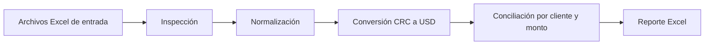

# Automatización de conciliación bancaria con Python

## Objetivo

Este proyecto automatiza la conciliación mensual entre:

- Facturación mensual del shared service (`Monthly_Billing.xlsx`).
- Estado de cuenta BAC en dólares.
- Estado de cuenta BAC en colones.
- Tipo de cambio diario.

El resultado es un reporte Excel que identifica las facturas pagadas, pendientes y los créditos bancarios que no pudieron asociarse a una factura.

## Regla de negocio

La facturación mensual está expresada completamente en dólares.

La automatización considera únicamente los créditos bancarios, porque representan ingresos recibidos en la cuenta.

Los créditos del banco en dólares se comparan directamente contra el billing.

Los créditos del banco en colones se convierten a dólares usando el tipo de cambio de la fecha del crédito:

```text
Monto en USD = Monto en CRC / Tipo de cambio del día
```

## Flujo del proceso



## Estructura de scripts

| Script | Función |
|---|---|
| `01_inspect_inputs.py` | Revisa archivos, hojas, columnas, tipos de datos y valores vacíos. |
| `02_normalize_inputs.py` | Limpia nombres, fechas, códigos y montos. Conserva solo créditos bancarios. |
| `03_reconcile_billings.py` | Compara billings contra créditos bancarios usando cliente y monto en USD. |
| `04_generate_excel_report.py` | Genera el reporte final con resumen y detalle. |
| `run_automation.py` | Ejecuta todos los pasos en el orden correcto. |

## Archivos de entrada

Los archivos deben estar en:

```text
C:\Users\Usuario\OneDrive\Escritorio
```

Archivos esperados:

```text
Monthly_Billing.xlsx
EstadoBancario_BAC_colones.xlsx
EstadoBancario_BAC_dolares.xlsx
Tipo de Cambio.xlsx
```

## Cómo ejecutar el proceso

Desde la carpeta del proyecto:

```powershell
python python_automation/run_automation.py
```

El proceso genera los resultados en:

```text
python_automation/results
```

El archivo principal es:

```text
reporte_conciliacion_bancaria.xlsx
```

## Contenido del reporte

El reporte incluye cuatro hojas:

### Resumen

Muestra el total de billings, pagadas, pendientes, diferencias y créditos bancarios sin identificar.

### Conciliación

Contiene cada billing y su resultado de conciliación, incluyendo fecha de pago, moneda bancaria, monto original, monto convertido y diferencia.

### Pendientes

Lista únicamente las facturas que no encontraron un crédito bancario coincidente.

### Créditos no identificados

Lista los créditos bancarios que no pudieron asociarse a un billing.

## Criterio de conciliación

Una billing se marca como pagada cuando se encuentra un crédito bancario que cumple:

1. El código del cliente coincide.
2. El monto convertido a USD coincide.
3. La diferencia es menor o igual a USD 0.05.
4. El crédito bancario no ha sido utilizado por otra billing.

## Beneficios de usar Python

### Sin costo por tokens

La lógica se ejecuta localmente en la computadora. No depende de llamadas a modelos de inteligencia artificial ni de consumo de tokens.

### Repetible

El mismo proceso puede ejecutarse cada mes con los nuevos archivos, reduciendo el trabajo manual.

### Menos errores

Python aplica las mismas reglas de conversión y conciliación en cada ejecución.

### Trazabilidad

Se conservan archivos normalizados, resultados de conciliación y créditos no identificados para facilitar revisiones y auditorías.

### Escalable

El proceso puede ampliarse para manejar más bancos, más monedas, pagos parciales, fechas de facturación y diferentes tolerancias.

### Integración con Excel

El equipo financiero puede continuar trabajando con archivos Excel, mientras Python ejecuta la parte repetitiva y propensa a errores.

## Supuestos actuales

- `Monthly_Billing.xlsx` contiene montos en USD.
- Los créditos bancarios son los únicos movimientos considerados como ingresos.
- El tipo de cambio representa colones por dólar.
- Si existe más de una tasa para una misma fecha, se conserva la última tasa registrada.
- La conciliación actual se basa en código de cliente y monto.
- El archivo de billing todavía no contiene una fecha ni un identificador oficial de factura.

## Mejoras futuras

- Agregar fecha de billing e identificador oficial de factura.
- Incorporar pagos parciales.
- Conciliar pagos agrupados o divididos en varios depósitos.
- Agregar una tolerancia configurable.
- Incorporar bitácora de ejecuciones.
- Crear pruebas automáticas para fechas, monedas y montos.
- Programar la ejecución mensual en Windows Task Scheduler.
- Agregar notificaciones por correo cuando existan pendientes o diferencias.

## Tecnologías utilizadas

- Python.
- pandas para lectura, limpieza y transformación de datos.
- openpyxl para generar y dar formato al reporte Excel.
- Excel como formato de entrada y salida.

